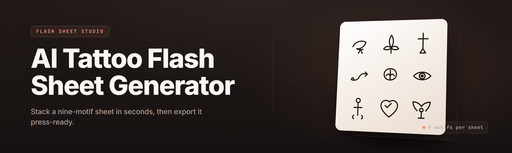

  
  
  

  

  
  

---

**Generate studio-ready tattoo flash sheets from a text prompt in under 90 seconds.**

---

## 📖 Table of Contents

- [Overview](#-overview)
- [What is AI Tattoo Flash Sheet Generator](#-what-is-ai-tattoo-flash-sheet-generator)
- [Quick Start](#-quick-start)
- [The Problem](#-the-problem)
- [The Solution](#-the-solution)
- [Key Features](#-key-features)
- [Flash Style Modules](#-flash-style-modules)
- [Linework & Shading Engines](#-linework--shading-engines)
- [Sheet Layout & Composition](#-sheet-layout--composition)
- [Export & Print Pipeline](#-export--print-pipeline)
- [Comparison](#-comparison)
- [System Requirements](#-system-requirements)
- [Installation](#-installation)
- [Usage Guidelines](#-usage-guidelines)
- [Tips for Best Results](#-tips-for-best-results)
- [Hotkeys](#-hotkeys)
- [Known Issues](#-known-issues)
- [FAQ](#-faq)
- [Module Status Table](#-module-status-table)

---

## 🖋️ Overview

| Category | Details |
|---|---|
| Product | AI Tattoo Flash Sheet Generator — Pro |
| Release Year | 2026 |
| Platform | Windows 10 / 11 (64-bit) |
| Distribution | Portable `.exe` — no installer, no Python, no Node |
| Primary Use | Tattoo artists, apprentices, flash collectors, studio owners |
| Output Formats | PNG (300 DPI), PDF, SVG, PSD-layered |
| Model Backend | Local diffusion + LoRA style stack (bundled, offline) |
| License | MIT (open-source repo) |

This is a desktop tool built for working tattoo artists and flash collectors. It takes a plain-text prompt — a motif, a style, a mood — and turns it into a full flash sheet: multiple cohesive designs, consistent linework, correct canvas proportions, ready to print or hand to a client. It runs entirely offline. Your prompts, your sheets, your machine.

  

---

## 🎨 What is AI Tattoo Flash Sheet Generator

| Term | Explanation |
|---|---|
| **Flash Sheet** | A printed or digital sheet of tattoo designs traditionally hung in a studio window for clients to pick from. |
| **Flash Style** | A named aesthetic (American Traditional, Neotraditional, Fine Line, Blackwork, Irezumi, etc.) that governs lineweight, palette, and shading language. |
| **Linework Engine** | The module that renders clean, closed contour lines at consistent weight — the backbone of tattooable art. |
| **Sheet Composer** | The layout module that arranges generated designs into a structured sheet (grid, radial, stacked, staggered). |
| **LoRA Stack** | Bundled style adapters the app applies to the base diffusion model to reproduce a specific flash aesthetic. |
| **Stencil Mode** | A high-contrast, single-line output variant for producing transfer stencils. |
| **Motif Seed** | Your text prompt plus any locked structure (e.g. "snake + dagger, symmetric, 4 sheets"). |

**Why artists reach for it:**

- Turn a 3-hour flash session into a 3-minute prompt session.
- Keep a whole personal style library — every sheet reproducible from a saved seed.
- Produce client-preview sheets before committing to a single design.
- Build a digital flash book without opening a drawing app.
- Print at 300 DPI directly to standard flash-sheet paper sizes.
- Keep it offline — no cloud uploads, no account, no telemetry.

---

## 🚀 Quick Start

1. 🗂️ **Visit the project page** and grab the release archive for Windows.
2. 📦 **Extract** the archive to any folder (e.g. `C:\Tools\AI-Tattoo-Flash\`).
3. ▶️ **Launch** the `.exe` inside the extracted folder. No installer runs.
4. ✍️ **Type a prompt** in the prompt bar — e.g. `traditional dagger with rose, bold lines`.
5. 🖼️ **Pick a style + sheet size**, hit Generate, and export when the sheet looks right.

First launch runs a one-time model warm-up (about 20 seconds). After that, generation is fast.

---

## 😤 The Problem

- **Flash takes forever by hand.** A single clean sheet is hours of drawing, inking, and layout.
- **Client previews are guesswork.** You sketch a concept, the client says "not quite," and you start over.
- **Style consistency drifts.** Designs on one sheet don't match in lineweight or palette.
- **Layout eats time.** Even good designs need to be arranged, spaced, and labeled properly.
- **Cloud AI tools leak your work.** Uploading a prompt to a web service means someone else holds your art.
- **Generic image AI doesn't know tattoo rules.** Closed lines, skin-readable contrast, and size limits matter.
- **No reproducible seeds.** You can't regenerate last month's sheet when a client wants it again.

---

## 🧩 The Solution

| Problem | Solution |
|---|---|
| Flash takes hours by hand | Prompt-to-sheet generation in under 90 seconds |
| Client previews are guesswork | Generate 4–8 variant sheets from one prompt before committing |
| Style drift on a sheet | Locked LoRA stack keeps every design on-sheet consistent |
| Layout eats time | Sheet Composer auto-arranges to grid, radial, stacked, or staggered templates |
| Cloud tools leak work | Fully offline — no uploads, no account, no telemetry |
| Generic AI ignores tattoo rules | Linework Engine enforces closed contours and skin contrast |
| No reproducible seeds | Every sheet saves its seed + style + params as a re-loadable `.flash` file |

---

## 🔪 Key Features

Alternating prose and module bullets, grouped by what the feature actually does for you.

The core generator is the engine everything else hangs from. You type a motif, select a style, and the app produces a batch of tattooable designs that share lineweight, palette, and shading language. Every downstream module — linework, shading, layout, export — operates on that batch.

**Core Generation**
- **Prompt-to-Batch** — one prompt yields 4 to 16 designs in a single pass.
- **Motif Lock** — pin a subject (snake, dagger, rose, koi) and vary the composition around it.
- **Symmetry Mode** — force bilateral or radial symmetry for mandala and traditional work.
- **Negative Prompt** — exclude elements you don't want ("no text", "no color fills").
- **Batch Seeding** — save and reload the exact seed for reproducible sheets.
- **Multi-Style Blend** — merge two style stacks with a weighted slider.

  

---

## 🖌️ Flash Style Modules

Each style is a bundled LoRA stack tuned to a specific flash tradition. You don't need to configure anything — pick one, generate.

**Style Pack — Traditional & Neotraditional**
- **American Traditional** — bold black outlines, limited palette, classic anchors and swallows.
- **Neotraditional** — thicker lines, wider palette, ornamental framing.
- **Sailor Jerry Tribute** — mid-century flash vocabulary, warm reds and greens.
- **Old School Rose** — high-contrast petal shading, tight linework.

**Style Pack — Fine Line & Minimal**
- **Fine Line** — hairline single-pass contours, low contrast, delicate.
- **Minimalist Black** — negative-space heavy, single-weight lines.
- **Dotwork Minimal** — stipple shading with sparse linear accents.

**Style Pack — Blackwork & Geometric**
- **Blackwork Bold** — heavy fills, high coverage, silhouette-driven.
- **Geometric Mandala** — radial symmetry, concentric rings, precise spacing.
- **Sacred Geometry** — interlocking shapes, line-precision priority.
- **Tribal Fusion** — flowing black shapes, negative-space channels.

**Style Pack — Irezumi & Eastern**
- **Irezumi Traditional** — Japanese motif vocabulary, background waves and wind bars.
- **Neo-Irezumi** — modern palette applied to traditional Japanese structure.
- **Koi & Dragon Set** — preset motif bundles for the two most-requested subjects.

---

## ✏️ Linework & Shading Engines

These two modules run after the base generation and are the reason output looks tattooable rather than like generic AI art.

**Linework Engine**
- **Closed-Contour Enforcement** — detects and closes open paths before export.
- **Weight Uniformity** — normalizes lineweight across a design to a target value.
- **Taper Control** — optional brush-style taper for fine line and Irezumi work.
- **Stencil Cleanup** — removes interior noise for clean transfer output.
- **Vector Trace** — converts raster linework to SVG with adjustable fidelity.
- **Line-Weight Preview** — overlay showing effective weight at 1:1 print scale.

**Shading Engine**
- **Whip Shading** — traditional tapered stroke shading, palette-locked.
- **Dotwork Stipple** — density-controlled stipple with configurable dot spacing.
- **Black & Grey Wash** — smooth grayscale gradients for portrait and realism.
- **Color Fill Regions** — flat fills with palette constraint, edge-aware.
- **Contrast Guard** — warns if any region drops below skin-readable contrast.
- **Shading Layer Export** — outputs shading as a separate PSD layer for artists who want to finish by hand.

---

## 🗂️ Sheet Layout & Composition

The Sheet Composer takes your generated batch and arranges it into a structured, print-ready sheet. Templates cover the common flash layouts used in studios.

**Layout Templates**
- **Classic Grid** — clean rows and columns, equal spacing, labels below each design.
- **Radial Fan** — designs arranged around a central anchor, good for mandala sets.
- **Stacked Column** — vertical single-column layout for narrow sheets.
- **Staggered Board** — organic spacing for a hand-drawn sheet feel.
- **Hero + Support** — one large design with smaller supporting designs around it.
- **Contact Sheet** — dense thumbnail grid for client previews.

**Composition Controls**
- **Sheet Size Presets** — A4, A3, Letter, Tabloid, and custom dimensions.
- **Gutter Control** — adjustable spacing between designs.
- **Label Toggle** — show or hide design titles below each piece.
- **Border & Frame** — optional decorative sheet border.
- **Watermark Slot** — your studio name or IG handle in a corner.
- **Save/Load Layout** — every layout saves as a reusable template.

---

## 🖨️ Export & Print Pipeline

The export pipeline is built for shops: correct DPI, correct color, correct file type for whatever comes next.

**Export Formats**
- **PNG** — 300 DPI raster, transparent or white background.
- **PDF** — multi-page or single, print-ready at correct sheet size.
- **SVG** — vector linework for editing or scaling without loss.
- **PSD** — layered output (linework, shading, color) for finishing by hand.

**Print Controls**
- **DPI Selector** — 150, 300, 600.
- **Bleed & Crop Marks** — toggleable for commercial printing.
- **Color Profile** — sRGB or Adobe RGB.
- **Ink-Saver Mode** — reduces heavy fills for test prints.
- **Batch Export** — export an entire project folder at once.
- **Sheet Naming Convention** — auto-named with prompt, style, and seed.

---

## ⚖️ Comparison

| Aspect | Alternative | This Tool |
|---|---|---|
| **Where it runs** | Cloud web app | Fully offline desktop `.exe` |
| **Prompt privacy** | Uploaded to a server | Stays on your machine |
| **Tattoo rules** | Not enforced | Linework Engine enforces closed contours |
| **Sheet layout** | Manual assembly | Sheet Composer auto-arranges |
| **Style consistency** | Per-image, drifts | Locked LoRA stack per sheet |
| **Reproducibility** | Regenerate from scratch | Save/load `.flash` seed files |
| **Export** | Single PNG | PNG, PDF, SVG, PSD |
| **Cost** | Subscription | Free, open repo |

---

## 💻 System Requirements

| Component | Minimum | Recommended |
|---|---|---|
| OS | Windows 10 (64-bit) | Windows 11 (64-bit) |
| CPU | 4-core, AVX2 | 8-core, Ryzen 5 / i5 12th gen or better |
| RAM | 8 GB | 16 GB |
| GPU | Integrated (CPU mode) | NVIDIA RTX 3060 6 GB+ / AMD RX 6600 |
| VRAM | — | 6 GB+ for GPU mode |
| Disk | 6 GB free | 12 GB free (style packs + cache) |
| Display | 1280×720 | 1920×1080 |
| Input | Mouse | Pen tablet (optional) |

CPU mode works but slower. GPU mode is strongly recommended for full-sheet generation.

---

## 🛠️ Installation

1. **Download the archive.** Head to the project page and grab the latest Windows release. The archive contains the `.exe` plus the model and style-pack folders.
2. **Extract to a folder.** Right-click the archive, extract to a folder you control (e.g. `C:\Tools\AI-Tattoo-Flash\`). Keep the folder structure intact — the `.exe` looks for `models\` and `styles\` next to it.
3. **Run the `.exe`.** Double-click the executable inside the extracted folder. Windows SmartScreen may warn on first run; allow it. No admin rights required. First launch warms up the model once.

---

## ✅ Usage Guidelines

| Allowed | Not allowed |
|---|---|
| Generate flash for your own studio or portfolio | Claiming AI-generated designs as exclusively hand-drawn without disclosure |
| Print sheets for client previews | Reselling the bundled style packs as your own |
| Export to PSD and finish by hand | Redistributing the `.exe` bundled with proprietary model weights |
| Modify and fork the repo under MIT | Using the tool to reproduce a living artist's signature style and pass as theirs |
| Use commercially on your own designs | Removing license files from redistributed copies |

---

## 💡 Tips for Best Results

- Be **specific about the motif** — "dagger wrapped in snake" beats "tattoo idea".
- Pick the **style first**, then the motif — the style stack changes what the prompt reads best as.
- Use **Negative Prompt** to kill unwanted text, signatures, or color fills.
- Generate a **batch of 8**, not 1 — variation is the point of a flash sheet.
- Check the **Contrast Guard** overlay before export; skin readability matters more than screen.
- Save every sheet as a `.flash` file so you can regenerate it exactly when a client returns.
- For fine line, lower the taper and raise fidelity — weight uniformity matters at small sizes.
- For blackwork, raise fill coverage but watch **Ink-Saver Mode** on test prints.

---

## ⌨️ Hotkeys

| Key | Action |
|---|---|
| `Ctrl + N` | New sheet |
| `Ctrl + G` | Generate batch |
| `Ctrl + R` | Regenerate with new seed |
| `Ctrl + L` | Open layout templates |
| `Ctrl + E` | Export current sheet |
| `Ctrl + Shift + E` | Batch export project |
| `Ctrl + S` | Save `.flash` seed file |
| `Ctrl + O` | Load `.flash` seed file |
| `F` | Toggle full-screen sheet view |
| `Space` | Pause/resume generation queue |

---

## 🐛 Known Issues

| Issue | Fix |
|---|---|
| First launch takes ~20s to warm up | Expected — model loads once. Subsequent launches are fast. |
| GPU mode falls back to CPU silently | Check GPU driver; re-run the launcher to re-detect the device. |
| SVG export loses fine dotwork detail | Raise vector trace fidelity before export. |
| SmartScreen warning on first run | Allow the app — the `.exe` is unsigned in this release. |
| PSD layer order looks off in older Photoshop | Open PSD in Photoshop 2020 or newer; older versions re-order layers. |
| Sheet export at 600 DPI is very slow on CPU | Use GPU mode, or reduce DPI to 300 for previews. |

---

## ❓ FAQ

**1. Do I need Python, Node, or Git to run this?**
No. Download the archive, extract it, and run the `.exe`. Everything is bundled.

**2. Does it need an internet connection?**
No. The generator runs fully offline once extracted. No accounts, no uploads.

**3. Is it really free?**
Yes — the repo is MIT-licensed. No subscription, no watermark on your exports.

**4. Can I use the output commercially?**
Yes, for your own studio or portfolio work. Don't resell the bundled style packs or model weights themselves.

**5. Does it run without a dedicated GPU?**
Yes — CPU mode works. It's slower, especially at 600 DPI. A 6 GB+ GPU is recommended.

**6. Can I add my own flash styles?**
Yes. Drop a compatible LoRA adapter into the `styles\` folder and it will appear in the style list on next launch.

**7. Can I edit the sheets in Photoshop?**
Yes — export as PSD and you'll get separate linework, shading, and color layers.

**8. Does it save my prompts?**
Only locally, inside your project folder. Nothing leaves the machine.

**9. Why does SmartScreen warn me?**
The `.exe` is unsigned in this release. Allow it manually — the source is public in the repo.

**10. Can I run multiple sheets at once?**
Yes. Queue up multiple prompts and export the whole project in one batch.

---

## 📊 Module Status Table

| Module | Status | Description |
|---|---|---|
| Prompt-to-Batch | ✅ Working | Core generation from a single prompt |
| Motif Lock | ✅ Working | Pins subject, varies composition |
| Symmetry Mode | ✅ Working | Bilateral / radial symmetry enforcement |
| Negative Prompt | ✅ Working | Exclude unwanted elements |
| Batch Seeding | ✅ Working | Save / load reproducible seeds |
| Multi-Style Blend | ✅ Working | Weighted merge of two style stacks |
| American Traditional | ✅ Working | Classic bold-line style pack |
| Neotraditional | ✅ Working | Ornamental style pack |
| Fine Line | ✅ Working | Hairline contour style pack |
| Blackwork Bold | ✅ Working | Heavy-fill silhouette pack |
| Geometric Mandala | ✅ Working | Radial precision pack |
| Irezumi Traditional | ✅ Working | Japanese motif vocabulary pack |
| Linework Engine | ✅ Working | Closed-contour enforcement |
| Weight Uniformity | ✅ Working | Lineweight normalization |
| Stencil Cleanup | ✅ Working | Transfer-ready line output |
| Vector Trace | ✅ Working | Raster-to-SVG linework |
| Whip Shading | ✅ Working | Traditional tapered shading |
| Dotwork Stipple | ✅ Working | Density-controlled stipple |
| Black & Grey Wash | ✅ Working | Grayscale gradient shading |
| Contrast Guard | ✅ Working | Skin-readability overlay |
| Shading Layer Export | ✅ Working | PSD layer output |
| Classic Grid | ✅ Working | Layout template |
| Radial Fan | ✅ Working | Layout template |
| Staggered Board | ✅ Working | Hand-drawn feel layout |
| Hero + Support | ✅ Working | Single hero design layout |
| Contact Sheet | ✅ Working | Dense thumbnail layout |
| PNG Export | ✅ Working | 300 DPI raster |
| PDF Export | ✅ Working | Print-ready multi-page |
| SVG Export | ✅ Working | Vector output |
| PSD Export | ✅ Working | Layered output |
| Bleed & Crop Marks | ✅ Working | Commercial print toggles |
| Batch Export | ✅ Working | Whole-project export |
| Watermark Slot | ✅ Working | Studio name / handle |
| Layout Save / Load | ✅ Working | Reusable layout templates |
| Hotkey Suite | ✅ Working | Full keyboard workflow |
| Queue System | ✅ Working | Multi-prompt batching |
| GPU / CPU Toggle | ✅ Working | Device selection |
| Ink-Saver Mode | ✅ Working | Reduced-fill test prints |
| Seed File (.flash) | ✅ Working | Save / reload full sheet state |

---

The AI Tattoo Flash Sheet Generator started as a weekend experiment to see if a prompt could produce a sheet a trad artist would actually tape to the wall. It got close enough to keep going. Today it's a full flash pipeline — generation, linework, shading, layout, export — that runs offline on your own machine and hands you a printable sheet in under two minutes.

If you draw flash by hand, this doesn't replace the pen. It replaces the hours of layout, the throwaway sketches, and the "let me try three more ideas" loop. Bring the prompt, keep the sketchbook open next to it.

  

